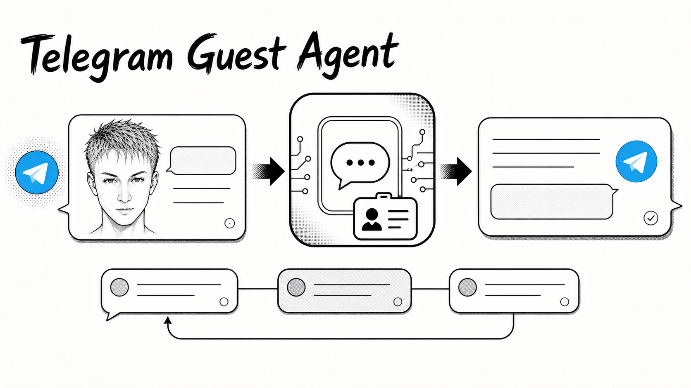

# Telegram Guest Agent

<p align="center">
  
</p>

Owner-only Telegram Guest Mode gateway for Hermes and compatible AI harnesses. It accepts a guest request, gives the agent a isolated, durable reply context, and returns a safe Telegram response without exposing the harness, local files, or credentials.

**Install:** [English](docs/installation.en.md) · [Русский](docs/installation.ru.md)

## What it does

- Polls `guest_message` updates with a dedicated Telegram bot token, avoiding `getUpdates` conflicts with a main bot.
- Fails closed: only the numeric `GUEST_OWNER_ID` may invoke the agent.
- Starts a new session for every standalone mention; an explicit mention replying to any registered owner request, placeholder, or bot answer resumes that exact branch, including after other branches or gateway restarts.
- Uses Hermes Runs with a stable `session_id` and matching `X-Hermes-Session-Key`. `HERMES_NATIVE_SESSIONS=1` lets the dedicated Hermes profile own history and compaction. Standard Chat Completions and legacy Runs retain the bounded gateway transcript.
- Replaces the initial placeholder with live, privacy-safe activity such as «Открываю страницу…» or «Запускаю тесты…» when Hermes reports a real tool event.
- Supplies the latest Bot-API-visible profile photo as tool input when an explicit avatar task targets the exact author of a replied message or a `text_mention`. Plain `@username` targets are routed to the guarded Userbot operation instead of being guessed.
- Persists requests, frozen Runs payloads and active run IDs before acknowledging updates. After a sidecar restart it resumes polling that run; a lost start response is recovered with the same durable Hermes `Idempotency-Key`.
- Sends additions to an active reply branch through Hermes `/runs/{run_id}/steer`, producing one combined answer. A late or rejected addition becomes the next turn in the same session.
- Downloads inbound media into a sandbox, caps its size, and sanitizes local paths in every public answer.
- Preserves the original Telegram `chat_id`, `message_id`, and `sender_id` beside voice/audio media so an installed `userbot` skill can use Telegram-native MTProto transcription instead of silently falling back to Whisper.
- Stages explicitly allowed local output media through the owner DM before reusing the returned Telegram `file_id` in a public rich reply.
- Uses Bot API 10.3 rich message blocks when available, including compact tables, expandable quotations, and embedded documents; falls back to ordinary text if Telegram rejects the rich payload.

## Session behaviour

```text
@bot + no reply                  -> new branch A
reply to A's request/answer + @bot -> continue A (steer if running)
@bot + no reply                  -> new branch B
reply to an old A answer + @bot   -> return to A
reply to another person + @bot   -> new branch C, with that quoted message
reply without @bot               -> ignored
```

Each branch is scoped to the bot, chat, topic and invoking owner. Other users
cannot invoke the agent or append messages to its history. Only an explicit
Telegram mention in the current message can start work: an ordinary reply,
an unrelated mention or a bot command alone produces no answer or reaction.
`GUEST_BOT_USERNAME` is required for username mentions; an unset value never
turns off the mention gate. The same gate applies to restored queued requests.
Only the current owner request and its immediate reply target enter the payload; nested replies
and surrounding chat history are excluded. An unknown or expired bot answer
starts a fresh branch with its visible text as a quote, never the latest branch.
Inline answer IDs are decoded using Telegram's known 20/24-byte formats and
validated against the source peer. Unsupported IDs fail closed.

Branches expire after **30 days of inactivity** (`GUEST_SESSION_TTL=2592000`).
The gateway retains at most 200 inactive/active recent branches plus in-flight
work, and 10,000 answer anchors. Each transcript holds the initial exchange and
up to 23 recent exchanges, bounded to 120,000 characters (30,000 per message).
This is a bounded conversation window, not an unlimited archive. Anchors and
history are persisted atomically in the private `runtime/state.json` (0600).
The retention policy governs gateway state; it does not delete Hermes logs or
archives. Only one run executes per branch. Additions arriving while it runs are steered into it;
otherwise they start the next turn. Other branches may run in parallel when workers permit.
The default remains one worker because browser/tool resources may be shared.

With `HERMES_NATIVE_SESSIONS=1`, Hermes Runs receives only the new input, stable
session ID and transport instructions. Hermes restores that exact session's native
history, including tool results and compaction summaries; the gateway does not
replace it with a truncated transcript. The gateway retains routing metadata and
pending work, and clears its compatibility transcript after a successful native
turn. Existing branch IDs remain unchanged. Before enabling this on an existing
installation, verify that those IDs exist in the dedicated profile's session store.
A missing native session must be investigated before migration.

With `HERMES_NATIVE_SESSIONS=0` (the compatibility default), Runs receives the
bounded authoritative gateway history, including an explicit fresh-session boundary.
Chat Completions always receives that bounded history. The bootstrap disables
shared profile memory and external memory providers for the dedicated guest
profile; persona, skills and tool access remain profile-owned.

Steering is delivered at a safe boundary chosen by Hermes; it does not forcibly
terminate a running tool. The gateway persists acceptance and retires accepted
additions with the parent job. Hermes' steer endpoint has no idempotency contract:
a timeout with an unknown outcome is not blindly retried. The addition is retained
for a subsequent turn with an instruction to check native history before repeating
any action. A `409` at run completion also becomes a normal same-session turn.

When upgrading from the older 120-second routing, ambiguous legacy anchors are
not imported. Queued requests survive, but start isolated sessions. An answer
sent before this upgrade can supply quoted text, not reconstruct missing history.

## Quick start

```bash
git clone https://github.com/eugeneb1ack/telegram-guest-agent.git
cd telegram-guest-agent
./init-env.sh
./setup-hermes-profile.sh --clone-from default
$EDITOR .env  # add only the Telegram token, owner ID, and bot username
./run-docker.sh
```

The Hermes bootstrap creates a dedicated profile, gives its API server the full
`hermes-cli` capability bundle, generates a separate bearer key, connects the
sidecar, and exposes only the profile's generated-image cache through a
read-only media mount. It never writes credentials, persona, or skills into
the repository. Omit `--clone-from default` for a clean profile with bundled
skills, or clone from another local profile to preserve its custom
skills/persona/provider authentication. The complete setup for Hermes or
another harness is in the [English installation guide](docs/installation.en.md)
and [Russian installation guide](docs/installation.ru.md).

Run a connectivity check before enabling polling:

```bash
./run-docker.sh --check
```

## Harness contract

The gateway is intentionally narrow transport glue. Keep persona, tools, and policy in the harness profile, not in this repository.

| Mode | Required endpoint | Context contract |
| --- | --- | --- |
| `HERMES_USE_RUNS=1` | `POST /v1/runs`, `GET /v1/runs/{run_id}`; `POST /v1/runs/{run_id}/steer`; optional `GET /v1/runs/{run_id}/events` | Stable `session_id` and matching `X-Hermes-Session-Key`; native history/compaction when enabled, otherwise authoritative `conversation_history`. Durable start idempotency is required for lost-response recovery. |
| `HERMES_USE_RUNS=0` | OpenAI-style `POST /v1/chat/completions` | Receives a normal `messages` array; this gateway supplies the same bounded local reply history. |

History ownership is selected as described above; both modes keep durable branch routing. `GUEST_PENDING_ANCHOR_TTL` is obsolete and no longer affects routing. Both modes expect a bearer token and return ordinary text. Chat Completions responses must contain `choices[0].message.content`.

### Telegram-native voice transcription

`GUEST_TELEGRAM_NATIVE_STT_REQUIRED=1` is the safe default for Telegram voice,
audio, and video-note speech tasks. The gateway puts the source chat, message,
and sender IDs in the same `media_context` section as the downloaded media and
adds a system-level routing rule: load the harness profile's `userbot` skill,
use its canonical Telethon module and Telegram's native MTProto transcription,
and accept only a complete provenance-matched result. Whisper, Ollama, ffmpeg,
and external STT are not permitted as silent fallbacks. If the profile has no
working userbot integration, the agent must report that limitation instead of
inventing or substituting a transcript.

This project does not package Telegram user sessions or Telethon credentials.
Install the userbot runtime and skill separately, then clone that configured
Hermes profile with `setup-hermes-profile.sh --clone-from ...`. Generic
harnesses that deliberately own a different transcription policy can set
`GUEST_TELEGRAM_NATIVE_STT_REQUIRED=0` explicitly.

### Generated-media completion contract

For a generated image or file, a successful harness tool call is not yet a
completed Telegram task. The Runs request names the exact host-side
`GUEST_HARNESS_MEDIA_DIR`; the harness must copy or export the final artifact
there, verify that the file exists, and return a standalone
`MEDIA:/absolute/path/inside/that/directory` line with its human-readable
answer. The sidecar stages that file in the owner's DM, reuses Telegram's
returned `file_id`, and appends the media block to the final rich article.
Paths from a workspace, project, or temporary directory remain blocked and
redacted even if the underlying generation tool succeeded.

For an explicit avatar/profile-photo request, the sidecar calls
`getUserProfilePhotos` only after an exact user ID is available from the
replied message or a `text_mention`. The largest current photo is downloaded
through the inbound media bridge and exposed in
`media_context.person_targets` as tool input. A plain `@username` contains no
Bot API user ID, so the harness must use the guarded Userbot
`download_profile_photo` operation. If the first answer to an explicit media
task has no verified allowlisted artifact, the sidecar performs one corrective
run in the same isolated session. It never loops or silently chooses a
similarly named user.

Explicit animation/GIF requests also require a verified media artifact. A failed
Codex run whose output contains Hermes' subscription-error diagnostic is treated
as a provider failure, not a saved partial answer: details stay in logs, the chat
gets a short failure notice, and completed tools are not replayed automatically.

Generated general files are staged through the same private owner-DM bridge as
images and embedded as Bot API 10.3 `document` blocks. Markdown tables use the
new compact cell layout. An explicit `<blockquote expandable>` block is kept as
a native collapsible quotation; ordinary quotations remain ordinary, so the
renderer does not unexpectedly hide content.

The sidecar injects a capability-aware formatting policy on every Hermes turn,
including follow-ups in native sessions. It teaches when to use a real comparison
table, short prose, headings, lists, quotations, optional details, emphasis, code,
links, footnotes, formulas and media. The contract and examples are documented in
[Telegram Rich Text formatting](docs/rich-text.md). The renderer preserves table
alignment, literal/escaped pipes, code spans, heading levels, and nested details
with their initial open state. Tables wider than Telegram's 20-column limit stay
readable as preformatted text instead of invalidating the entire rich answer.

## Live activity status

In Hermes Runs mode, the gateway consumes the structured SSE lifecycle stream and updates the existing Telegram placeholder only when the harness reports actual activity. Each supported action has distinct start, working, completion, and failure phases. Fixed public categories cover planning, skills, tool discovery, browser navigation and interaction, internet search and extraction, command-line work, scripts, tests, code checks, builds, repository work, file search and reading, code changes, documents, media, data, context, task plans, communication, automation, external tools, and subagents.

Production status delivery is event-driven; periodic working-phrase heartbeats are disabled to conserve Telegram request limits. Terminal previews are inspected only in memory to select a broad category such as tests, build, script, repository, or file search. Raw tool names, arguments, previews, commands, URLs, file names, local paths, partial model output, and model reasoning are never copied into Telegram. Unknown tools use varied generic start/working/completion phrases.

Updates are coalesced and rate-limited by `GUEST_PROGRESS_MIN_INTERVAL`; set `GUEST_PROGRESS_ENABLED=0` to disable them. Completion events wake final-answer reconciliation immediately; an authenticated GET remains authoritative. While SSE is connected, reconciliation runs every five seconds (or the configured poll interval, if longer). If SSE is unavailable, polling uses `HERMES_POLL_INTERVAL`. New owner additions also wake reconciliation, so steering does not wait for the five-second timer.

Set `GUEST_PROGRESS_CATS=1` and configure `GUEST_PLACEHOLDER_CUSTOM_EMOJI_ID` /
`GUEST_PLACEHOLDER_CUSTOM_EMOJI_ALT` for one custom emoji beside static «Думаю…».
Telegram animates the sticker client-side; the bot does not edit messages to
animate dots or rotate working phrases. Status edits follow actual tool/phase
events, coalesced to at least four seconds apart, with a shared limit across workers.
Actual tool activity retains its own emoji and label. Telegram flood-control
pauses suppress cosmetic edits. Final edits wait for `retry_after` and retry the
same rich payload (up to three attempts, waits up to 120 seconds per rejection);
a 429 never triggers a plain-text downgrade. Status delivery runs in the background.
Timers stop and in-flight edits finish before final delivery, so a status cannot
overwrite the answer.

A strictly matched fresh, text-only greeting (for example, «Хэй» or «hello»)
uses `model_options.reasoning_effort=low` on the same model and native session.
Replies, media and substantive requests keep the profile's reasoning settings.
This reduces unnecessary latency without a canned response or a second model.

## Delivery recovery and readiness

Guest Mode supports one reply per invocation, including in chats where the bot
is not a member. The default delivery path answers the guest query once and
edits the returned `inline_message_id`. Rich media uses previously uploaded
Telegram `file_id` values; an inline edit does not upload new files.

The gateway persists the completed answer and staged media IDs before final
delivery. Transient failures of an existing inline edit are retried with
backoff, at most eight delivery attempts, including after a restart. Recovery
does not call the model or upload the same staged media again. Transport-level
429 handling shares a cooldown across sends, uploads and edits, honors
`retry_after`, and preserves the rich payload. Temporary network/server errors
do not trigger a plain-text downgrade; explicit payload rejection still can.

An upload or new send can succeed even if its response is lost. Such ambiguous
operations remain in `pending_jobs` with `delivery.phase=review` for operator
reconciliation instead of being repeated automatically. A failed owner fallback
does not remove the saved answer. The original guest reply remains the retry
target; an owner fallback is attempted at most once.

Each attachment has its own durable upload record and checksum. A confirmed
`file_id` is saved immediately, before the next upload. A definite 429 rejection
may be retried with backoff; already uploaded files are reused after restart.
Unknown upload outcomes (including timeouts or server errors), missing receipts
and changed/missing files retain the answer for review instead of marking a
text-only response as successfully delivered.

Admission reactions, queue acknowledgements and steering notices use a separate
FIFO worker. They skip flood-control waits and use short network timeouts.
Incoming messages and steering do not wait for these cosmetic Telegram requests.
The task worker coordinates with an outstanding acknowledgement so it reuses
the existing guest placeholder instead of racing a second `answerGuestQuery`.
Steering and completion notices are ordered to prevent late queue text from
overwriting the final acknowledgement.

`--check` and polling startup validate the token's bot username and Guest Mode
capability. In Hermes Runs mode they also validate the v1 URL, profile health
and authenticated model discovery. Failures stop startup before consuming
Telegram updates. Generic Chat Completions mode keeps support for custom
endpoints without requiring Hermes-specific health or discovery routes.

A missing state file is treated as a first start. An unreadable, malformed or
structurally invalid existing state file stops startup with `StateLoadError`;
it is never silently replaced by an empty queue. Preserve that file and restore
a verified backup before restarting. Automatic rollback to an older offset is
intentionally avoided because it could replay already executed requests.

State writes skip unchanged data and use compact JSON. With native Hermes
sessions enabled, old gateway transcripts may be archived using the following
offline utility while the sidecar is stopped:

```bash
python3 compact_guest_state.py --state runtime/state.json --hermes-db /path/to/profile/state.db
# Review the counts, then repeat with --apply.
```

Every archived conversation must appear in order in the native Hermes database.
Unverified transcripts are retained. `--apply` saves an owner-only copy of the
entire original state beside `state.json`, preserves reply anchors and session
IDs, and never writes to the Hermes database.

## Privacy and security model

- Do not reuse the Telegram token of another polling bot.
- `.env`, `runtime/`, `state.json`, generated media, and logs are ignored by Git. Never commit or publish them.
- `runtime/state.json` contains accepted owner requests, their explicit reply targets, answers and queued work. The gateway writes it atomically with owner-only file permissions where supported; the Docker helper runs as the host UID/GID so `runtime/` may remain `0700` and state files `0600`.
- Inbound media is untrusted and lands in `/sandbox/inbound` in Docker. The container is non-root, read-only, drops Linux capabilities, uses `no-new-privileges`, and has a constrained temporary filesystem.
- The Docker runner derives the host side of the media bridge from the active checkout on every start; Compose uses that exact path for both the bind mount and the path given to the harness, preventing stale media paths after a deployment move.
- Local files may be staged only from `GUEST_OWNER_MEDIA_ALLOWED_DIRS`. Everything else is rejected. Public responses redact `MEDIA:`, `file://`, Windows paths, and sensitive POSIX paths.
- Generated harness files are accepted only from the explicitly configured `GUEST_HARNESS_MEDIA_DIR`. Compose mounts that one directory read-only at `/sandbox/harness-output`; it does not mount the Hermes profile, credentials, skills, or history. Accepted files are sent to the owner DM first, then their Telegram `file_id` is embedded in the guest rich article.
- Telegram-native transcription receives only source provenance through the prompt. Telethon credentials, account environment files, and session files stay in the separate userbot runtime and must never be mounted into this container or committed here.
- Rotate credentials if they ever appear in a terminal capture, issue, commit, or public message.

## Development

The project has no third-party Python runtime dependency.

```bash
PYTHONDONTWRITEBYTECODE=1 python3 -m unittest -q
python3 -m py_compile guest_gateway.py rich_renderer.py
bash -n init-env.sh setup-hermes-profile.sh run-docker.sh install-launchagent.sh run.sh
```

The test suite covers queue durability, context routing, Runs payloads and live activity privacy, Chat Completions reply history, rich-message fallback, media constraints, and path sanitization.

## Repository layout

| Path | Purpose |
| --- | --- |
| `guest_gateway.py` | Telegram polling, durable queue, context resolution, harness clients, media and delivery safeguards. |
| `rich_renderer.py` | Conservative Markdown/Rich HTML to Telegram rich-block renderer. |
| `compose.yaml` / `Dockerfile` | Hardened container deployment. |
| `setup-hermes-profile.sh` | Creates or connects a dedicated full-tool Hermes profile without committing secrets. |
| `.env.example` | Safe configuration template with placeholders only. |
| `docs/` | English and Russian installation guides. |
| `assets/` | README artwork only; never runtime or user media. |

## macOS service (optional)

`install-launchagent.sh` writes a per-user launchd job that starts `run-docker.sh`. It is optional and assumes the repository lives at `$HOME/Documents/telegram-guest-agent` unless `APP_DIR` is set. Docker Desktop works directly; the runner automatically uses Colima only when its socket already exists.

## License

This project is released under the [MIT License](LICENSE).
